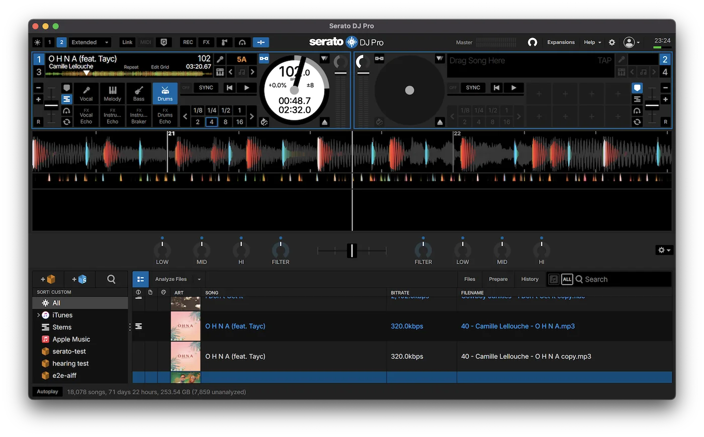

## NUO-STEMS 4.1 is here 🎉

Large libraries stay responsive, long sessions hold up better, and settings are easier to change. The release is stable. Serato DJ support is in the same installer and remains alpha.

{/* truncate */}

## Performance

Scrolling a large Traktor collection is smoother, and the window freezes less while you work. Reopening a collection is faster as well.

## Stability

Long sessions, including overnight runs, should crash less often. Stopping a job cleans up after itself, and quitting saves the queue before the app exits.

## Easier settings

**Sum = Original** is now in Quick Settings. Switching between Traktor, DAW, and Serato picks suitable defaults and asks before applying them.

## Serato DJ (alpha)

Select **Serato DJ** mode, add your tracks, and NUO-STEMS writes stems next to the originals for Serato DJ Pro and Lite. If stems are already there, you can keep them or generate them again. The walkthrough is in [Serato mode](/docs/getting-started/serato).

:::warning Serato integration is in alpha
It can still break. If Serato rejects a stems file, it moves that file to the Trash. [Serato mode](/docs/getting-started/serato) explains when that happens.
:::

The [Serato extraction utility](/docs/utilities/extract-individual-stems-from-serato-stems) lets you preview each part and save it as an MP3, for free, without running separation again.

A few things are easy to miss:

- [Keep Serato DJ closed while generating stems](/docs/getting-started/serato), then reopen it to load them.
- [Restart Serato after replacing existing stems](/docs/getting-started/serato#restart-serato-after-changing-existing-stems). Serato can keep the previous version cached.
- [AAC and ALAC originals across macOS and Windows](/docs/getting-started/serato#platform-compatibility-for-aac--alac-originals).
- [Serato and Traktor stems are generated in separate passes](/docs/getting-started/serato#serato-and-traktor-cannot-be-generated-in-one-pass).

[Download NUO-STEMS](https://nuo-stems.com/#download) or read the [full 4.1.0 changelog](/docs/changelog).

If you try Serato integration, I’d love to hear how it works with your tracks. Share your feedback in [Discord](https://discord.gg/dfpk9FbvJE), or [contact support](/docs/contact-support) if you run into a problem.
